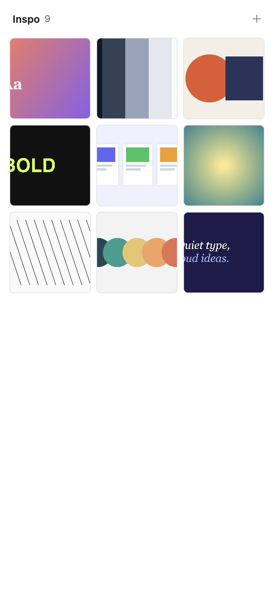
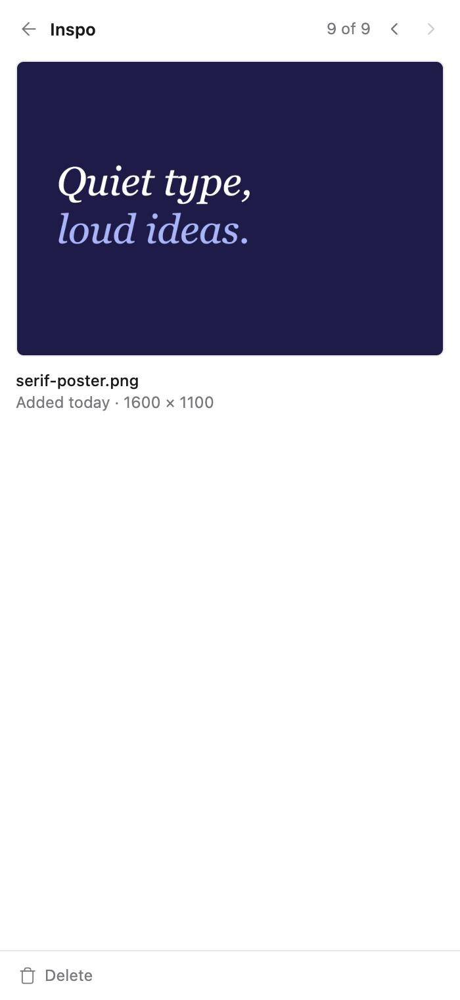

# Inspo

A visual inspiration board in Orca's right sidebar. Paste or drop screenshots and images while you work with your coding agent, so your references stay next to the conversation instead of getting lost in a Downloads folder.

<p>
  
  
  
</p>

## Use it

Open the **Inspo** tab (lightbulb icon) in Orca's right sidebar.

- **Paste:** click the panel, then press ⌘V to paste a screenshot from your clipboard.
- **Drop:** drag image files from Finder anywhere onto the panel.
- **Pick:** click **+** to choose images from your computer.
- **View:** click a thumbnail to see it larger. Use the arrows (or ← →) to step through, and Esc or the back arrow to return to the grid.
- **Delete:** open an image and click **Delete** at the bottom.

New images appear at the top of a three-column grid. The panel uses Orca's theme colors.

## Install

Install **Inspo** from the [Orca plugin directory](https://www.onorca.dev/plugins), or add it from this repository in Orca's plugin settings.

## Privacy

Images stay on your computer, in the plugin's own storage inside Orca. Inspo makes no network requests and asks for no Orca permissions beyond showing its own panel.

## Develop

```sh
orca plugin validate .
orca plugin dev watch .    # loads this folder into Orca, streams logs, and reloads on save; Ctrl-C unloads it
```

The whole panel is [panel/index.html](panel/index.html): plain HTML, CSS and JavaScript with no build step.

## License

[MIT](LICENSE)
